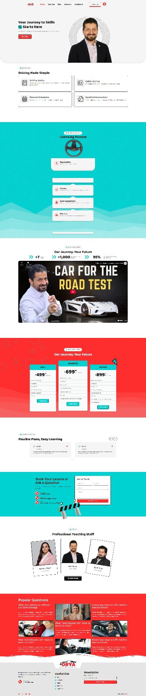
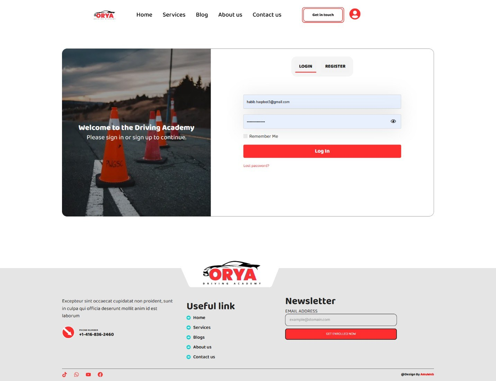
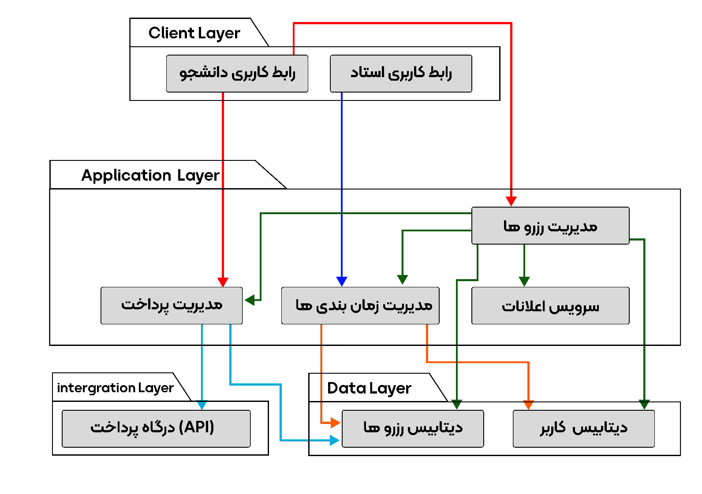
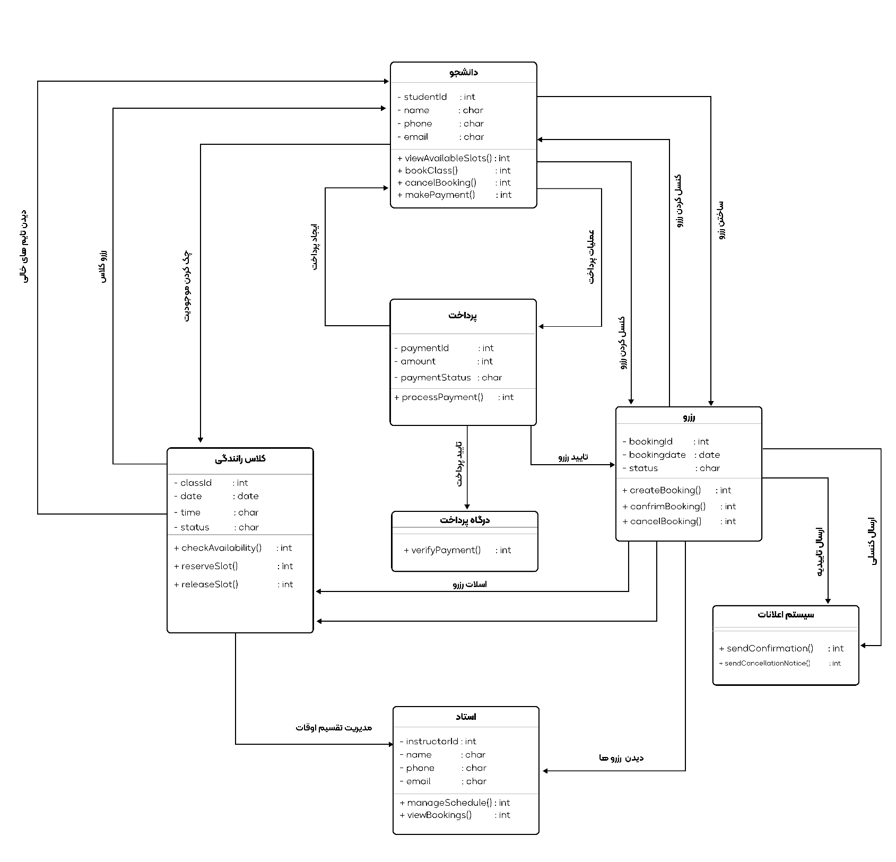
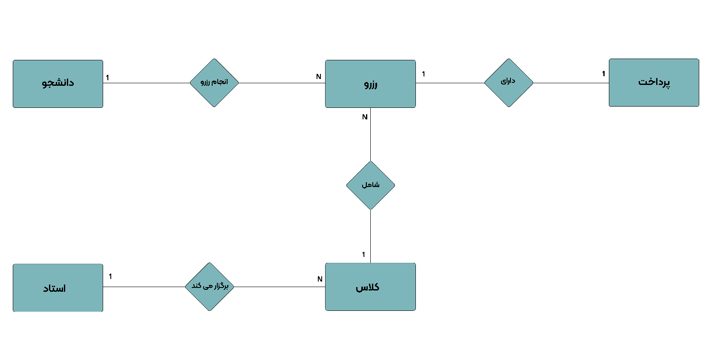

# Driving School Online Booking System: Analysis & Design

Software Engineering course project (B.Sc. Computer Engineering, Islamic Azad University, Autumn 2025).
Full software-engineering documentation for the online lesson-booking system of **[Orya Driving Academy](https://oryadrivingacademy.com/)**, a driving school in Toronto, Canada: requirements, UML models, database design, UI design, and a test and maintenance plan.

**Author:** Habibullah Haqdost · **Supervisor:** Fahimeh Banavi

## Case study: from design to a live website

I designed and built the Orya Driving Academy website, including its custom online booking feature, as a freelance project (live at [oryadrivingacademy.com](https://oryadrivingacademy.com/)). This course project documents the engineering behind it: who the users are, what the booking system must do, how it is structured, how its data is stored, and how it should be tested.

| Live website | Login / registration screen |
|---|---|
|  |  |

> This repository contains design documentation, not the website's source code. Some requirements (for example SMS reminders and admin reports) are planned features in the design.

## Contents

| Phase | What's inside |
|---|---|
| 1. Requirements | Objectives, 7 functional and 6 non-functional requirements, elicitation methods, stakeholder interview questions, a 12-item Requirements Traceability Matrix |
| 2. UML modeling | Use case, activity, class, object, statechart, sequence, component and deployment diagrams |
| 3. Database | ERD and a 5-table relational schema (students, instructors, classes, bookings, payments) |
| 4. UI design | Home page and login/registration screens |
| 5. Testing & maintenance | Localization (Toronto), usability, security, performance, unit and integration test plans; perfective maintenance plan |

📄 **Full report (English):** [docs/report-EN.md](docs/report-EN.md)
📄 **Original report (Persian, PDF):** [docs/report-FA-original.pdf](docs/report-FA-original.pdf)
🗄️ **Database schema:** [database/schema.sql](database/schema.sql)

## Architecture

Three-tier, layered design:

- **Client layer:** student and instructor web interfaces (HTTPS)
- **Application layer:** booking, scheduling, payment and notification services behind a REST API
- **Data layer:** users and bookings databases (MySQL)
- **Integration:** external payment gateway over a secure API

## Core flow

Student views free slots → books a lesson → pays → booking is confirmed → confirmation is sent; instructors view their bookings and manage their schedule.

## Database

Changes from the original report in `schema.sql`: MySQL syntax made consistent, a duplicate-booking constraint, time and capacity checks, a currency column (CAD), a `refunded` payment status, payment records protected from cascade deletion, and an `available_classes` view.

## Test plan highlights

| Test | Success criterion |
|---|---|
| Usability | A student books a lesson in under 2 minutes without training |
| Performance | Response time under 3 s with 100 concurrent users (JMeter) |
| Security | Password hashing, SQL injection and XSS prevention, access control (OWASP ZAP) |
| Localization | Toronto time zone, CAD prices, Canadian English |

## Diagrams

All diagrams are in [diagrams/](diagrams/). Labels are in Persian, as in the original report.
