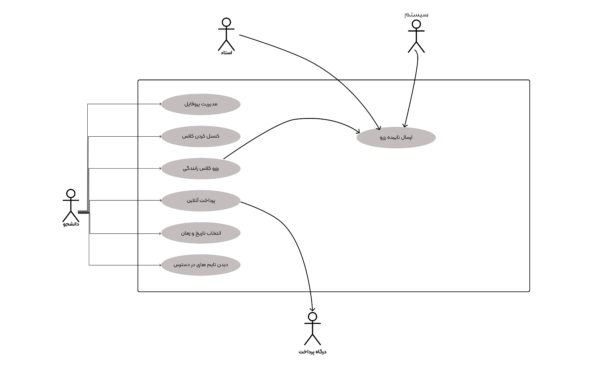
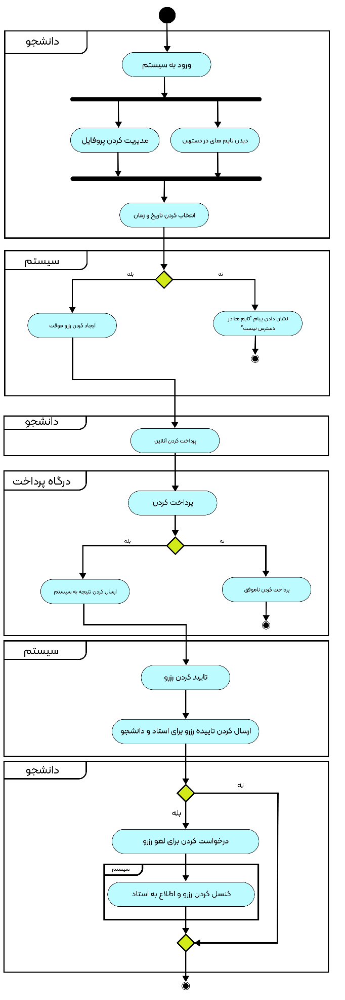
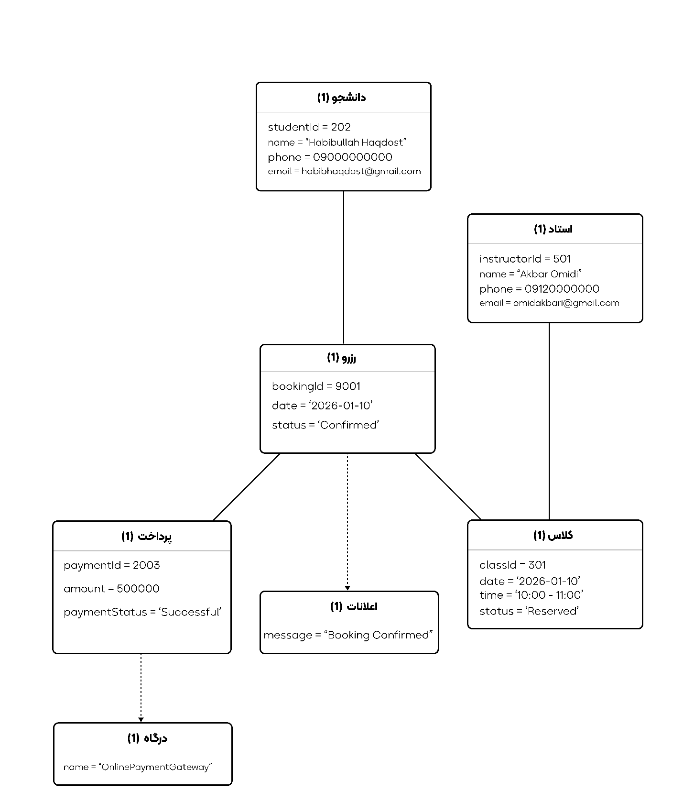
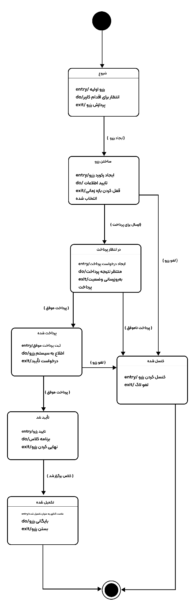
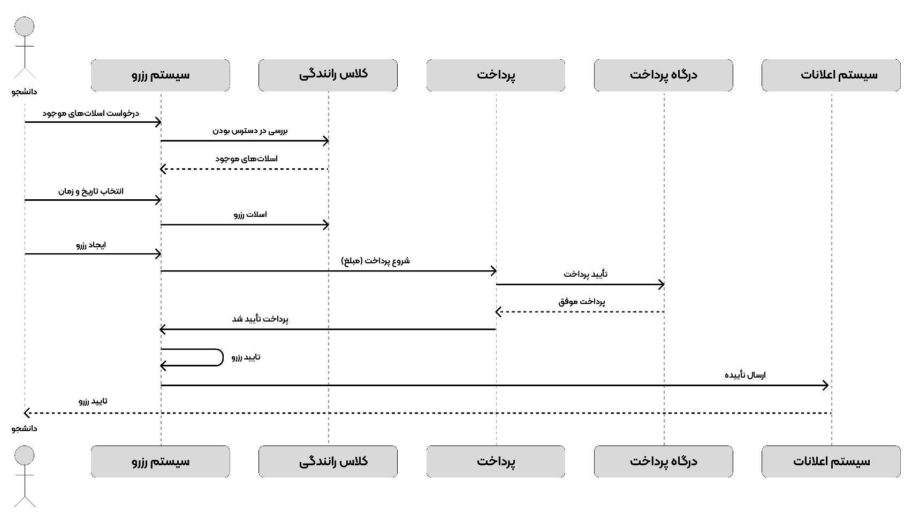
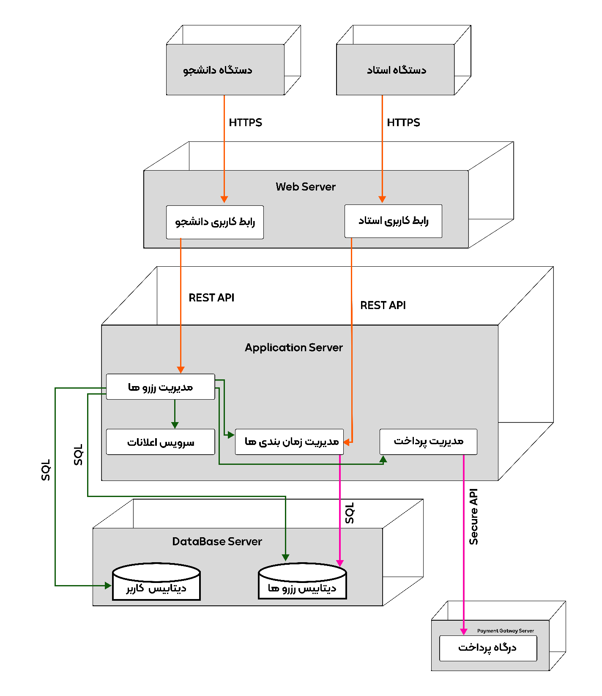

# Online Booking System for a Driving School
### Software Engineering Course Project

**Author:** Habibullah Haqdost
**Supervisor:** Fahimeh Banavi *(transliteration to be confirmed)*
**Term:** Autumn 2025 (Autumn 1404 in the Iranian calendar)

> English translation of the original Persian report. Translator's notes are marked *[Note: …]*. Diagrams are in [`diagrams/`](../diagrams/); their labels are in Persian in the original.

---

## Contents
1. Phase 1: Requirements Gathering
2. Phase 2: UML Modeling
3. Phase 3: Database Design
4. Phase 4: User Interface Design
5. Phase 5: Testing and Maintenance

---

## Phase 1: Requirements Gathering

### Introduction
The goal is to build a software system for booking driving lessons online, in order to simplify enrollment, reduce human error, save time, and improve communication between students, instructors and the school's management.

### Specific objectives
1. Design an online registration system for new students.
2. Allow students to book, cancel or reschedule practical and theory lessons.
3. Display instructors' schedules and the booking status of lessons.
4. Send automatic SMS or email reminders before lessons.
5. Let the school administrator manage instructors, courses and users.

### Requirements

**Functional requirements**
1. The system shall allow new students to register.
2. The system shall display the list of courses and instructors.
3. The system shall allow users to book and cancel driving lessons.
4. The system shall allow each instructor to view their own schedule.
5. The system shall store user, instructor and course data in a database.
6. The system shall send a notification to confirm a booking.
7. The school administrator shall be able to manage users, instructors and courses.

**Non-functional requirements**
1. **Usability:** the user interface must be simple and understandable for all users.
2. **Security:** user and instructor data must be encrypted and protected.
3. **Availability:** the system must be available 24/7.
4. **Performance:** registering and booking a lesson must take less than 3 seconds.
5. **Maintainability:** the system must be extensible and maintainable by a technical team.
6. **Compatibility:** the system must work correctly across browsers and devices.

### Requirements elicitation methods and sources

**Elicitation methods**
1. **Stakeholder interviews:** conversations with the school manager, instructors and students to identify real needs.
2. **Direct observation:** studying the school's current booking process.
3. **Questionnaire:** collecting students' opinions on current problems and their expectations of the system.
4. **Document review:** studying similar systems and other driving schools' booking websites.
5. **Competitor analysis:** evaluating the strengths and weaknesses of similar online booking systems.

**Sources**
1. Interviews with the manager and instructors of a local driving school.
2. Similar websites such as bookdrivinglesson.co.uk and drivingschool.com.
3. Software Engineering course materials.
4. Educational articles on requirements analysis and system design.
5. User experience of the school's actual students.

### Sample stakeholder interview questions
1. How are lessons booked today, and what problems does that cause?
2. What are your most important expectations of an online booking system?
3. What information about students and instructors should the system store?
4. Do you need the system to send lesson reminders?
5. Which reports (e.g. number of lessons, active instructors) matter to you?

### Sample customer (student) interview questions
1. How much time do you usually spend booking a driving lesson?
2. Would you prefer to book via mobile, website or in person?
3. What information would you like to see when booking?
4. Are SMS or email notifications useful to you?
5. If the system were online, would you be willing to complete the whole enrollment process remotely?

### Requirements Traceability Matrix (RTM)

| ID | Requirement | Type | Related objective | Use case | Expected test result | Status |
|---|---|---|---|---|---|---|
| R01 | Register a new student | Functional | Easier onboarding for students | UC01 – Register Student | Data entered and account created successfully | Approved |
| R02 | View courses and instructors | Functional | Transparency and easier booking | UC02 – View Instructors | Full list of instructors and time slots displayed | Approved |
| R03 | Book a driving lesson | Functional | Core function of the system | UC03 – Book Lesson | Lesson booked and confirmation received | Approved |
| R04 | Cancel or change a booking | Functional | Flexibility for users | UC04 – Cancel/Change Booking | Booking cancelled without error and database updated | In development |
| R05 | Show instructors' schedules | Functional | Better coordination between instructor and student | UC05 – Instructor Schedule | Instructor's bookings listed for a date range | Approved |
| R06 | Send reminder messages | Functional | Prevent missed lessons | UC06 – Send Reminder | Email or SMS sent before the lesson | Planned |
| R07 | Manage users and instructors | Functional | Overall control of the system | UC07 – Manage Users | Users added/removed successfully | Approved |
| R08 | Security and password login | Non-functional | Privacy and security | UC08 – Secure Login | Login only with the correct, hashed password | Approved |
| R09 | Simple Persian user interface | Non-functional | Better user experience | UC09 – UI Design | Persian pages with clear navigation | Approved |
| R10 | Mobile and browser support | Non-functional | Wider accessibility | UC10 – Responsive Design | Runs without issues on mobile and browsers | Under review |
| R11 | Fast system response | Non-functional | Better performance | UC11 – System Performance | Booking and page load under 3 seconds | Approved |
| R12 | Reporting for the administrator | Non-functional | Better decision-making | UC12 – Generate Reports | Statistical report of bookings generated | Planned |

*[Note: R09 specifies a Persian UI, but the UI screens in Phase 4 and the localization test in Phase 5 are in English for Toronto, Canada. R12 (reporting) is a functional requirement rather than a non-functional one.]*

---

## Phase 2: UML Modeling

### Phase 2 objectives
In this phase the project moves forward through analysis and diagram design. The diagrams model the online driving-lesson booking system:

- Use Case Diagram
- Activity Diagram
- Class Diagram
- Object Diagram
- Statechart Diagram
- Sequence Diagram
- Communication Diagram
- Component Diagram
- Deployment Diagram

*[Note: the original lists nine diagrams, but eight are included; the Communication Diagram is missing.]*

1. **Use Case Diagram:** 

   

2. **Activity Diagram:** 

   

3. **Class Diagram:** 

   
. Classes: Student, Driving Class, Booking, Payment, Payment Gateway, Instructor, Notification System.
   - Student: studentId, name, phone, email; viewAvailableSlots(), bookClass(), cancelBooking(), makePayment()
   - Driving Class: classId, date, time, status; checkAvailability(), reserveSlot(), releaseSlot()
   - Booking: bookingId, bookingDate, status; createBooking(), confirmBooking(), cancelBooking()
   - Payment: paymentId, amount, paymentStatus; processPayment()
   - Payment Gateway: verifyPayment()
   - Instructor: instructorId, name, phone, email; manageSchedule(), viewBookings()
   - Notification System: sendConfirmation(), sendCancellationNotice()
   - Relationships (labels): view free time slots, book class, check availability, create booking, cancel booking, create payment, process payment, confirm payment, confirm booking, reserve slot, manage schedule, view bookings, send confirmation, send cancellation.
4. **Object Diagram:** 

   

5. **Statechart Diagram:** 

   

6. **Sequence Diagram:** 

   

7. **Component Diagram:** 

   
. Layers: Client Layer (student UI, instructor UI), Application Layer (booking management, scheduling management, payment management, notification service), Integration Layer (payment gateway API), Data Layer (bookings database, users database).
8. **Deployment Diagram:** 

   
. Student and instructor devices connect over HTTPS to a Web Server, which calls an Application Server through a REST API; the Application Server uses SQL to reach a Database Server (users and bookings databases) and a secure API to reach an external payment gateway.

---

## Phase 3: Database Design

### Phase 3 objectives
In this phase the project database is built with Microsoft SQL Server, and an Entity-Relationship Diagram (ERD) is drawn.

*[Note: the SQL below uses `AUTO_INCREMENT` and `ENUM`, which are MySQL syntax and do not run on Microsoft SQL Server. MySQL is also what WordPress uses. See [`database/schema.sql`](../database/schema.sql) for a corrected version.]*

**ERD:** 

   


The database has five tables: students, instructors, driving classes, bookings and payments.

```sql
CREATE TABLE students (
    student_id INT AUTO_INCREMENT PRIMARY KEY,
    first_name VARCHAR(50) NOT NULL,
    last_name VARCHAR(50) NOT NULL,
    phone VARCHAR(20) UNIQUE NOT NULL,
    email VARCHAR(100) UNIQUE,
    password_hash VARCHAR(255) NOT NULL,
    created_at TIMESTAMP DEFAULT CURRENT_TIMESTAMP
);

CREATE TABLE instructors (
    instructor_id INT AUTO_INCREMENT PRIMARY KEY,
    first_name VARCHAR(50) NOT NULL,
    last_name VARCHAR(50) NOT NULL,
    phone VARCHAR(20) UNIQUE NOT NULL,
    license_number VARCHAR(50) UNIQUE NOT NULL,
    experience_years INT DEFAULT 0,
    created_at TIMESTAMP DEFAULT CURRENT_TIMESTAMP
);

CREATE TABLE classes (
    class_id INT AUTO_INCREMENT PRIMARY KEY,
    instructor_id INT NOT NULL,
    class_date DATE NOT NULL,
    start_time TIME NOT NULL,
    end_time TIME NOT NULL,
    capacity INT DEFAULT 1,
    price DECIMAL(10,2) NOT NULL,
    FOREIGN KEY (instructor_id)
        REFERENCES instructors(instructor_id)
        ON DELETE CASCADE
);

CREATE TABLE bookings (
    booking_id INT AUTO_INCREMENT PRIMARY KEY,
    student_id INT NOT NULL,
    class_id INT NOT NULL,
    booking_date TIMESTAMP DEFAULT CURRENT_TIMESTAMP,
    status ENUM('pending','confirmed','cancelled') DEFAULT 'pending',
    FOREIGN KEY (student_id)
        REFERENCES students(student_id)
        ON DELETE CASCADE,
    FOREIGN KEY (class_id)
        REFERENCES classes(class_id)
        ON DELETE CASCADE
);

CREATE TABLE payments (
    payment_id INT AUTO_INCREMENT PRIMARY KEY,
    booking_id INT UNIQUE NOT NULL,
    amount DECIMAL(10,2) NOT NULL,
    payment_method ENUM('card','cash','online') NOT NULL,
    payment_status ENUM('pending','paid','failed') DEFAULT 'pending',
    payment_date TIMESTAMP DEFAULT CURRENT_TIMESTAMP,
    FOREIGN KEY (booking_id)
        REFERENCES bookings(booking_id)
        ON DELETE CASCADE
);
```

---

## Phase 4: User Interface Design
- **Website home page:** 

   

- **User login / registration page:** 

   


---

## Phase 5: Testing and Maintenance

### Localization testing (Toronto)
**Goal:** verify that the system fits the Toronto, Canada locale.
**Checked items:**
- Date and time format (DD/MM/YYYY or MM/DD/YYYY)
- Time zone (Toronto, EST)
- Prices shown in Canadian dollars (CAD)
- Canadian English
- Compliance with local online payment rules
- Lesson times shown correctly for the time zone

**Expected result:** a user in Toronto experiences the system as fully local and natural.

### Usability testing
**Goal:** check how easy the system is to use.
**Test scenarios:**
- Can a student book a lesson without any training?
- Number of clicks needed to book a lesson (should be low)
- Clarity of buttons and forms
- How quickly a free lesson slot can be found
- Usability on mobile

**Success criteria:**
- A lesson booked in under 2 minutes
- No user confusion

### Security testing
**Goal:** protect user and payment data.
**Test cases:**
- Password hashing
- SQL injection prevention
- XSS prevention
- User authentication and sessions
- Online payment security
- Preventing unauthorized access by instructors or students

**Suggested tools:** OWASP ZAP / Burp Suite

### Performance testing
**Goal:** check system speed under load.
**Test scenario:**
- 100 concurrent users booking
- Loading the list of lessons
- Server response time

**Success criteria:**
- Response time under 3 seconds
- No system crash

**Suggested tools:** JMeter / LoadRunner

### Unit testing
Testing the smallest pieces of code in isolation.
**Examples:** user registration function, lesson booking function, lesson price calculation function, payment function.
**Goal:** make sure each function works correctly on its own.

### Integration testing
Testing the interaction between modules.
**Modules tested:**
- Registration → Login
- Lesson booking → Payment
- Payment → Sending confirmation
- Instructor → Lesson management

**Goal:** make sure the parts of the system work together correctly.

### Chosen maintenance approach: Perfective Maintenance
**Definition:** improving the system after release to raise quality and user satisfaction.
**Activities:**
- Adding new features
- Improving the user interface
- Increasing system speed
- Optimizing the database
- Adding reports and statistics
- Improving the mobile user experience

**Examples in this project:**
- Adding an instructor rating system
- Adding SMS lesson notifications
- Adding an advanced lesson search filter

**Main goal:** increase user satisfaction and continuously improve the system.

---

*Many thanks to my supervisor, Fahimeh Banavi, for the valuable guidance and support throughout this project.*
